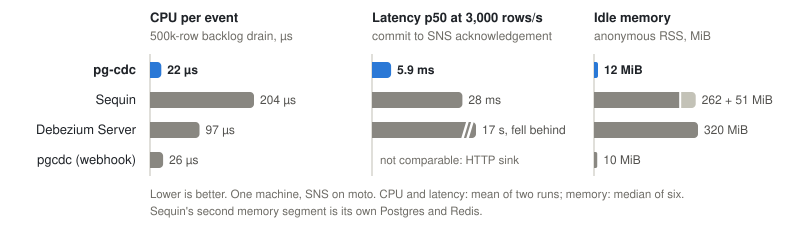

# pg-cdc

pg-cdc reads row changes from a Postgres publication through a logical replication slot (pgoutput) and publishes each change as a JSON message to Amazon SNS, FIFO or standard, for fan-out to SQS queues and other subscribers. It is one Rust binary that never writes to the source database.

## What it guarantees

- **At-least-once delivery.** Every committed change in the publication is delivered, held in the state store, or still retained by the slot for replay. Each event has an `id` derived from its commit LSN and position, identical on every replay as long as the publication's tables do not change while transactions are unacknowledged, so consumers dedupe on it. A slot that is dropped or invalidated loses the changes it held ([runbook](docs/runbook.md#4-aurora-failover-and-slot-loss)).
- **Order per key.** Events with the same order key (by default the table and primary key) are published in commit order, one at a time. A failing key backs off and retries on its own, and other keys keep flowing as long as the state store answers promptly: parking runs inside the lane that owns the key, so a slow store also delays that lane's healthy keys. FIFO topics and queues keep that order through to consumers; standard topics may reorder, and ids compare in stream order.
- **Bounded WAL during a sink outage.** An event still undelivered `delivery.park_after` (30 s by default) after its first failure is parked in a state store (S3, or a local directory) along with the later events of its key, so the slot keeps advancing once the store has taken them. Parked events are redelivered in order once the sink recovers. If the state store is also unavailable, or the parked limit is reached, pg-cdc stops reading and Postgres holds the WAL instead; nothing is dropped.
- **One active reader, with fenced takeover.** The replication slot is the lock: only one task streams, and others wait as standbys. On SIGTERM the active task drains and hands over cleanly; after a crash, the successor waits `leadership.fence_delay` before writing. A process paused longer than that can cause duplicate deliveries and, rarely, one key's events out of order, never loss ([details](docs/runbook.md#8-shutdown-health-and-startup-validation)).

## Why pg-cdc

pg-cdc is narrow on purpose: one Postgres publication, one SNS topic, run as a small service on AWS.

- **Small footprint.** One binary in a distroless image. Its only runtime dependencies are Postgres, SNS and S3 (or local disk): no Kafka, no JVM, no Redis, no extra database.
- **Native SNS.** On a FIFO topic the message group is the order key and the deduplication id is stable across replays and takeovers. Selected columns become message attributes for SNS subscription filters.
- **Per-key parking.** A long sink outage parks events in S3 instead of pinning WAL, and a row the sink rejects outright parks as dead and holds back only its own key's deliveries until an operator redrives or discards it.
- **Operable.** An admin API and `pg-cdc parked` list, redrive and discard parked events. OpenTelemetry traces, metrics and logs export over OTLP. Deploys start the new task first and hand the slot over without losing a change. RDS IAM authentication is built in.

How it compares:

- **Debezium** (Kafka Connect or Debezium Server) is the mature choice: many source databases, a large sink ecosystem, incremental snapshots and a big community. It runs on the JVM, usually with Kafka. With Kafka Connect, Kafka buffers changes, so a downstream consumer outage does not hold back the slot, but a Kafka outage does; with Debezium Server, an unavailable sink does. Choose it if you need those sources, sinks or snapshots, or already run Kafka.
- **Sequin** has backfills, many sinks (SNS among them), filtering and transforms, and a web console, and it also persists failing messages so the slot can advance. Self-hosted, it runs alongside its own Postgres and Redis. Choose it if you want those features and do not mind the extra components.
- **AWS DMS** is managed and does a full load plus ongoing changes, but it is built for migration and replication into databases, S3, Kinesis or Kafka, not SNS fan-out with per-key ordering.
- **LISTEN/NOTIFY** (`pg_notify`) needs no extra service, but a notification sent while no listener is connected is lost, payloads must be under 8,000 bytes, and sending them from triggers adds work to every write transaction.
- **Triggers with an outbox table** let the application shape events and add context, without a replication slot. They write to the source database on every change, and a poller adds latency and table churn.

Not yet supported: snapshots and backfills, sinks other than SNS (beyond stdout and discard for testing), transforms, more than one pipeline per process, and admin API authentication. See the [roadmap](docs/roadmap.md).

## Performance

On a local benchmark against Sequin, Debezium Server and [florinutz/pgcdc](https://github.com/florinutz/pgcdc), pg-cdc used the least CPU per event and the least memory of the SNS tools, and had the lowest latency at 3,000 rows/s. Its backlog drain rate tied Sequin's, because both were limited by the SNS emulator.

<picture>
  <source media="(prefers-color-scheme: dark)" srcset="docs/benchmarks-dark.svg">
  
</picture>

These come from one machine with SNS emulated by moto, which caps throughput and shapes latency, and pgcdc delivers over HTTP rather than SNS; see [Benchmarks](docs/benchmarks.md) for the method, every result, where pg-cdc ties or loses, and the caveats.

## Quickstart

Prepare Postgres: `wal_level = logical` (on RDS and Aurora, `rds.logical_replication = 1`), a role with `REPLICATION` (`rds_replication` on RDS), then the publication and slot. pg-cdc never creates or drops either. The [runbook](docs/runbook.md#1-setup) has the grants, IAM policy and S3 setup.

```sql
CREATE PUBLICATION pgcdc_orders FOR TABLE public.orders;
ALTER TABLE public.orders REPLICA IDENTITY FULL;
SELECT pg_create_logical_replication_slot('pgcdc_orders', 'pgoutput');
```

Write `pg-cdc.yaml`:

```yaml
pipeline: orders
source:
  host: db.internal
  database: app
  user: pgcdc
  credentials:
    type: password
  slot: pgcdc_orders
  publication: pgcdc_orders
sink:
  type: sns
  topic_arn: arn:aws:sns:us-east-1:123456789012:orders.fifo
state_store:
  type: s3
  bucket: pgcdc-state
  prefix: orders/
```

Run the image (linux/amd64 and linux/arm64), or build the binary with `cargo build --release -p pg-cdc`. The password comes only from the environment, and AWS credentials from the default credential chain.

```sh
docker run --rm -v "$PWD/pg-cdc.yaml:/etc/pg-cdc/config.yaml:ro" \
  -e PGCDC__SOURCE__CREDENTIALS__PASSWORD \
  -e AWS_REGION -e AWS_ACCESS_KEY_ID -e AWS_SECRET_ACCESS_KEY -e AWS_SESSION_TOKEN \
  ghcr.io/theia-vision-inc/pg-cdc:main
```

To try it locally without AWS, run the binary with `sink: { type: stdout }` and `state_store: { type: filesystem, path: ./pg-cdc-state }`, and set `source.tls.mode: disable` for a Postgres without TLS.

## Documentation

- [Configuration reference](docs/configuration.md): every key and default, the SNS message format, state and payload stores, telemetry.
- [Runbook](docs/runbook.md): setup, ECS deployment, handover, slot loss, parked events, alerts, the admin API and the container image.
- [Design](docs/superpowers/specs/2026-10-14-pg-cdc-design.md): architecture, event model, ordering, parking and leadership.
- [Roadmap](docs/roadmap.md): current limitations and planned work.
- [Benchmarks](docs/benchmarks.md): pg-cdc against Sequin, Debezium Server and pgcdc, with the harness in [`bench/`](bench).
- [Engineering](docs/engineering.md): building, testing and contributing.

## License

Licensed under either of [Apache License, Version 2.0](LICENSE-APACHE) or [MIT license](LICENSE-MIT) at your option. Contributions are dual licensed the same way.
